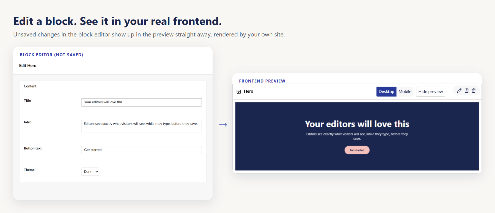
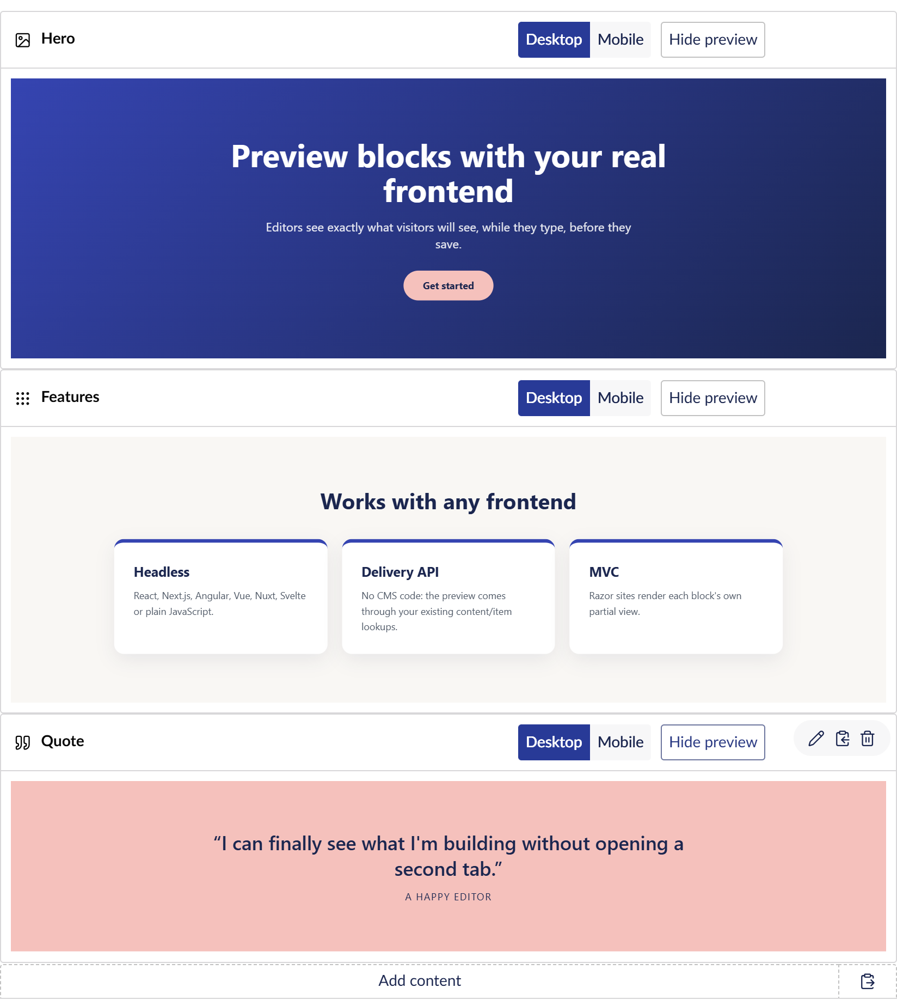

<p align="center">
  
</p>

<h1 align="center">Umbraco.Community.FrontendBlockPreview</h1>

<p align="center">
  Preview Block List and Block Grid blocks in the Umbraco backoffice, <strong>rendered by your real frontend</strong>,<br />
  with the editor's <strong>unsaved</strong> changes, for headless and MVC sites.
</p>

<p align="center">
  <a href="https://www.nuget.org/packages/Umbraco.Community.FrontendBlockPreview"></a>
  
  
</p>


Each block gets a **Preview** button. Clicking it shows the block exactly as your frontend renders it, at desktop or mobile width, and the preview updates as the editor types, before anything is saved.



**Works with any frontend.** React, Next.js, Angular, Vue, Nuxt, SvelteKit, Astro, plain JavaScript, or Razor views. Headless frontends need a handful of lines (or one script tag), shown for each framework [below](#hook-up-your-frontend).

**Multisite.** Each site can preview on its own frontend.

**Tested with** Nuxt 3 and Nuxt 4 frontends on both the Content Delivery API and custom page APIs, multisite installs with one themed frontend per site, MVC/Razor sites, and a framework-free JavaScript frontend.

---

## Contents

- [How it works](#how-it-works)
- [Install](#install)
- [Pick a renderer](#pick-a-renderer): [Content Delivery API](#content-delivery-api) · [Your own headless API](#your-own-headless-api) · [MVC / Razor](#mvc--razor)
- [Hook up your frontend](#hook-up-your-frontend): [Any site](#any-site-one-script-tag) · [React](#react-vite--react-router) · [Next.js](#nextjs-app-router) · [Angular](#angular) · [Vue](#vue-3--vue-router) · [Nuxt](#nuxt) · [SvelteKit](#sveltekit) · [Astro](#astro) · [Plain JavaScript](#plain-javascript)
- [Multisite](#multisite)
- [Settings](#settings)
- [Security](#security)
- [Limitations](#limitations)
- [Try it: the test site](#try-it-the-test-site)

---

## How it works

```
 Backoffice                       CMS                                  Your frontend
 ──────────                       ───                                  ─────────────
 Preview clicked ──── unsaved ──▶ converts it exactly as Save does,
 (or the editor      block value  keeps just this block, stores it
  keeps typing)                   for 10 minutes under a random token
                 ◀──── URL ────── {frontend}/block-preview/{token}/

 <iframe src=URL> ────────────────────────────────────────────────────▶ catch-all route asks the CMS
                                                                        for /block-preview/{token}/
                                  answers with the page, holding  ◀──── (like any other page)
                                  only the previewed block       ────▶ renders it with your components,
                                                                        hides the header and footer
 iframe sized to fit ◀────────────────── postMessage(height) ────────── 
```

Your frontend renders the preview with its own components, styles, fonts and data, so what the editor sees is what visitors will see. MVC sites skip the frontend column: the CMS renders the block's partial view itself.

## Install

```bash
dotnet add package Umbraco.Community.FrontendBlockPreview
```

Requires Umbraco 17 (.NET 10). Then pick a renderer in `appsettings.json`.

## Pick a renderer

| Your site | `Renderer` | CMS code needed | Frontend changes |
|---|---|---|---|
| Headless on the **Content Delivery API** | `DeliveryApi` | None | [A few lines](#hook-up-your-frontend) |
| Headless on **your own API** | `Custom` | One small class | [A few lines](#hook-up-your-frontend) |
| **MVC** / Razor views | `Razor` | None | None |

### Content Delivery API

```json
"FrontendBlockPreview": {
  "Renderer": "DeliveryApi",
  "DefaultFrontendUrl": "https://www.example.com"
}
```

Your frontend already asks the Delivery API for `content/item/{path}`. For `/block-preview/{token}/` the CMS returns the page being edited, in exactly the same JSON shape, with the block property holding only the previewed block. Your page template renders it like any other page.

If your frontend looks content up by id instead of by path, fetch `{cms}/block-preview/{token}` directly; it returns the same JSON.

> `AddDeliveryApi()` must come before `AddComposers()` in `Program.cs`. It does in Umbraco's default template.

### Your own headless API

If your CMS shapes its own JSON for the frontend, set `"Renderer": "Custom"` and tell the package how a page with one block looks:

```csharp
public class MyBlockPreviewRenderer : HeadlessBlockPreviewRendererBase
{
    private readonly IMyPageMapper _pageMapper;

    public MyBlockPreviewRenderer(IFrontendUrlResolver frontendUrlResolver, IMyPageMapper pageMapper)
        : base(frontendUrlResolver)
        => _pageMapper = pageMapper;

    // Optional: only these block types get the Preview button (null = all of them)
    public override IEnumerable<string>? GetSupportedBlockTypes() => _pageMapper.SupportedBlockAliases;

    // The JSON your frontend expects for a page.
    // context.Value is a BlockListModel / BlockGridModel holding only the previewed block,
    // context.Document is the saved draft of the page it's on.
    protected override object? BuildResponse(BlockPreviewContext context)
        => _pageMapper.Map(context.Document, (BlockListModel)context.Value!);
}
```

```csharp
builder.Services.AddUnique<IBlockPreviewRenderer, MyBlockPreviewRenderer>(ServiceLifetime.Scoped);
```

The response is served at `/block-preview/{token}` on the CMS, serialized with your site's MVC JSON settings. Point your frontend's catch-all route at it the same way it fetches any other page.

### MVC / Razor

```json
"FrontendBlockPreview": {
  "Renderer": "Razor",
  "Razor": {
    "Stylesheets": [ "/css/site.css" ],
    "Scripts": [ "/js/site.js" ]
  }
}
```

The CMS renders each block's partial view from `Views/Partials/blocklist/Components/{alias}.cshtml` (or `blockgrid/Components`) inside a minimal page with your stylesheets and scripts. Only blocks that have a partial view get the Preview button. The request is routed to the page being edited, so `Umbraco.AssignedContentItem` and `CurrentPage` work in your partials.

To use your own `<head>`, fonts and scripts, copy [`Views/FrontendBlockPreview/BlockPreview.cshtml`](../src/Umbraco.Community.FrontendBlockPreview/Views/FrontendBlockPreview/BlockPreview.cshtml) into your site and point `Razor:LayoutView` at it.



---

## Hook up your frontend

Headless frontends need three things, in any framework:

1. **A catch-all route** that renders `/block-preview/{token}/` by asking the CMS for that path, like any other page. Most headless frontends already have one.
2. **No site chrome** on `/block-preview/*`: hide the header, footer, cookie banner and chat widget.
3. **Report the height** so the backoffice can size the preview:

   ```js
   window.parent.postMessage({ type: 'frontend-block-preview:height', height: document.body.scrollHeight }, '*');
   ```

Points 2 and 3 can be one script tag in any framework, or a few lines in your layout. Both are shown below.

The route must render at request time. A page that is only generated at build time (static export / SSG without fallback) can't serve a token that's created while the editor works. Client-rendered routes and server-rendered routes both work.

### Any site: one script tag

Works in every framework, and in server-rendered HTML from PHP, Express, Django or anything else:

```html
<script
  src="https://your-cms.example.com/App_Plugins/FrontendBlockPreview/frontend-block-preview.js"
  data-hide="header, footer, .cookie-banner, #chat-widget"
  defer></script>
```

Outside the backoffice preview it does nothing. Inside it, it hides the `data-hide` elements, adds a `frontend-block-preview` class to `<html>` for any extra preview styles, and reports the height.

If your framework injects scripts itself and drops `data-` attributes, configure it before it loads:

```html
<script>window.FrontendBlockPreview = { hide: 'header, footer, .cookie-banner' };</script>
```

### React (Vite + React Router)

```jsx
// main.jsx: one route catches every path, including /block-preview/{token}/
<Routes>
  <Route element={<Layout />}>
    <Route path="*" element={<Page />} />
  </Route>
</Routes>
```

```jsx
// Page.jsx
export function Page() {
  const { pathname } = useLocation();
  const [page, setPage] = useState(null);

  useEffect(() => {
    fetch(`${import.meta.env.VITE_UMBRACO_URL}/umbraco/delivery/api/v2/content/item${pathname}`)
      .then(response => (response.ok ? response.json() : null))
      .then(setPage);
  }, [pathname]);

  return page && <Blocks items={page.properties.blocks.items} />;
}
```

```jsx
// Layout.jsx
export function Layout() {
  const isBlockPreview = useLocation().pathname.includes('/block-preview/');
  useBlockPreviewHeight(isBlockPreview);

  return (
    <>
      {!isBlockPreview && <Header />}
      <Outlet />
      {!isBlockPreview && <Footer />}
    </>
  );
}

function useBlockPreviewHeight(enabled) {
  useEffect(() => {
    if (!enabled || window.parent === window) return;

    const observer = new ResizeObserver(() =>
      window.parent.postMessage({ type: 'frontend-block-preview:height', height: document.body.scrollHeight }, '*'));
    observer.observe(document.body);

    return () => observer.disconnect();
  }, [enabled]);
}
```

A client-rendered app calls the CMS from the browser, so allow your frontend's origin in the CMS's CORS policy.

### Next.js (App Router)

```tsx
// app/[[...slug]]/page.tsx: the optional catch-all also matches /block-preview/{token}
import { notFound } from 'next/navigation';

export default async function Page({ params }: { params: Promise<{ slug?: string[] }> }) {
  const { slug = [] } = await params;

  const response = await fetch(`${process.env.UMBRACO_URL}/umbraco/delivery/api/v2/content/item/${slug.join('/')}`, {
    cache: 'no-store', // preview content changes on every keystroke
  });
  if (!response.ok) notFound();

  const page = await response.json();
  return <Blocks items={page.properties.blocks.items} />;
}
```

If you pre-render pages with `generateStaticParams`, keep `dynamicParams` on (the default) so `/block-preview/...` still renders on request.

The root layout is a Server Component, so the script tag is the easiest way to hide the chrome:

```tsx
// app/layout.tsx
import Script from 'next/script';

export default function RootLayout({ children }: { children: React.ReactNode }) {
  return (
    <html lang="en">
      <body>
        <Header />
        {children}
        <Footer />
        <Script id="block-preview-options" strategy="beforeInteractive">
          {`window.FrontendBlockPreview = { hide: 'header, footer' };`}
        </Script>
        <Script
          src={`${process.env.NEXT_PUBLIC_UMBRACO_URL}/App_Plugins/FrontendBlockPreview/frontend-block-preview.js`}
          strategy="afterInteractive"
        />
      </body>
    </html>
  );
}
```

On the Pages Router, the same applies: an optional catch-all `pages/[[...slug]].tsx` with `getServerSideProps` (or `getStaticProps` with `fallback: 'blocking'`), and the script in `_app.tsx`.

### Angular

```ts
// app.routes.ts
export const routes: Routes = [{ path: '**', component: PageComponent }];
```

```ts
// page.component.ts
@Component({
  selector: 'app-page',
  imports: [BlocksComponent],
  template: `@if (page(); as page) { <app-blocks [items]="page.properties.blocks.items" /> }`,
})
export class PageComponent {
  private http = inject(HttpClient);
  private route = inject(ActivatedRoute);

  page = toSignal(
    this.route.url.pipe(
      map(segments => segments.map(segment => segment.path).join('/')),
      switchMap(path => this.http.get<any>(`${environment.umbracoUrl}/umbraco/delivery/api/v2/content/item/${path}`)),
    ),
  );
}
```

```ts
// app.component.ts
@Component({
  selector: 'app-root',
  imports: [RouterOutlet, HeaderComponent, FooterComponent],
  template: `
    @if (!isBlockPreview) { <app-header /> }
    <router-outlet />
    @if (!isBlockPreview) { <app-footer /> }
  `,
})
export class AppComponent {
  isBlockPreview = inject(DOCUMENT).location.pathname.includes('/block-preview/');

  constructor() {
    // Browser only, so this is safe with Angular SSR too
    afterNextRender(() => {
      if (!this.isBlockPreview || window.parent === window) return;

      new ResizeObserver(() =>
        window.parent.postMessage({ type: 'frontend-block-preview:height', height: document.body.scrollHeight }, '*'),
      ).observe(document.body);
    });
  }
}
```

### Vue 3 + Vue Router

```js
// router.js
const routes = [{ path: '/:pathMatch(.*)*', component: Page }];
```

```vue
<!-- Page.vue -->
<script setup>
import { ref, watchEffect } from 'vue';
import { useRoute } from 'vue-router';

const route = useRoute();
const page = ref(null);

watchEffect(async () => {
  const response = await fetch(`${import.meta.env.VITE_UMBRACO_URL}/umbraco/delivery/api/v2/content/item${route.path}`);
  page.value = response.ok ? await response.json() : null;
});
</script>

<template>
  <Blocks v-if="page" :items="page.properties.blocks.items" />
</template>
```

```vue
<!-- App.vue -->
<script setup>
import { computed, onMounted } from 'vue';
import { useRoute } from 'vue-router';

const route = useRoute();
const isBlockPreview = computed(() => route.path.includes('/block-preview/'));

onMounted(() => {
  if (!isBlockPreview.value || window.parent === window) return;
  new ResizeObserver(() =>
    window.parent.postMessage({ type: 'frontend-block-preview:height', height: document.body.scrollHeight }, '*'),
  ).observe(document.body);
});
</script>

<template>
  <SiteHeader v-if="!isBlockPreview" />
  <RouterView />
  <SiteFooter v-if="!isBlockPreview" />
</template>
```

### Nuxt

`pages/[...path].vue` is already a catch-all. Fetch the page as usual:

```vue
<!-- pages/[...path].vue -->
<script setup>
const route = useRoute();
const { umbracoUrl } = useRuntimeConfig().public;
const { data: page } = await useFetch(`${umbracoUrl}/umbraco/delivery/api/v2/content/item${route.path}`);
</script>

<template>
  <Blocks v-if="page" :items="page.properties.blocks.items" />
</template>
```

```vue
<!-- layouts/default.vue -->
<script setup>
const route = useRoute();
const isBlockPreview = route.path.includes('/block-preview/');

onMounted(() => {
  if (!isBlockPreview || window.parent === window) return;
  new ResizeObserver(() =>
    window.parent.postMessage({ type: 'frontend-block-preview:height', height: document.body.scrollHeight }, '*'),
  ).observe(document.body);
});
</script>

<template>
  <SiteHeader v-if="!isBlockPreview" />
  <slot />
  <SiteFooter v-if="!isBlockPreview" />
</template>
```

Skip anything else you don't want in the preview the same way, e.g. analytics or chat scripts loaded from the layout.

### SvelteKit

```ts
// src/routes/[...path]/+page.server.ts
import { error } from '@sveltejs/kit';
import { UMBRACO_URL } from '$env/static/private';

export async function load({ params, fetch }) {
  const response = await fetch(`${UMBRACO_URL}/umbraco/delivery/api/v2/content/item/${params.path}`);
  if (!response.ok) error(404);
  return { page: await response.json() };
}
```

```svelte
<!-- src/routes/+layout.svelte -->
<script>
  import { onMount } from 'svelte';
  import { page } from '$app/state';

  let { children } = $props();
  const isBlockPreview = $derived(page.url.pathname.includes('/block-preview/'));

  onMount(() => {
    if (!isBlockPreview || window.parent === window) return;
    const observer = new ResizeObserver(() =>
      window.parent.postMessage({ type: 'frontend-block-preview:height', height: document.body.scrollHeight }, '*'));
    observer.observe(document.body);
    return () => observer.disconnect();
  });
</script>

{#if !isBlockPreview}<Header />{/if}
{@render children()}
{#if !isBlockPreview}<Footer />{/if}
```

### Astro

```astro
---
// src/pages/[...path].astro
import Layout from '../layouts/Layout.astro';
import Blocks from '../components/Blocks.astro';

export const prerender = false; // the preview token only exists at request time

const response = await fetch(`${import.meta.env.UMBRACO_URL}/umbraco/delivery/api/v2/content/item/${Astro.params.path ?? ''}`);
if (!response.ok) return Astro.redirect('/404');

const page = await response.json();
---
<Layout>
  <Blocks items={page.properties.blocks.items} />
</Layout>
```

```astro
---
// src/layouts/Layout.astro
const umbracoUrl = import.meta.env.PUBLIC_UMBRACO_URL;
---
<html lang="en">
  <body>
    <header>...</header>
    <slot />
    <footer>...</footer>
    <script is:inline src={`${umbracoUrl}/App_Plugins/FrontendBlockPreview/frontend-block-preview.js`} data-hide="header, footer"></script>
  </body>
</html>
```

### Plain JavaScript

The [demo frontend](../src/Umbraco.Community.FrontendBlockPreview.TestSite/frontend) in the test site is a complete headless frontend in one HTML file and one script, no framework: [`index.html`](../src/Umbraco.Community.FrontendBlockPreview.TestSite/frontend/index.html) and [`app.js`](../src/Umbraco.Community.FrontendBlockPreview.TestSite/frontend/app.js).

### Using your own API instead of the Delivery API?

The examples are the same. Swap the Delivery API URL for however your frontend fetches a page by path (e.g. `{cms}{path}`) and the CMS answers `/block-preview/{token}` with your [custom renderer](#your-own-headless-api)'s JSON.

### Let the backoffice frame your frontend

The preview is an iframe, so your frontend must not refuse to be framed by the CMS:

- no `X-Frame-Options: DENY` / `SAMEORIGIN` (at least on `/block-preview/*`)
- if you send a Content Security Policy, include the backoffice in `frame-ancestors`:

```
Content-Security-Policy: frame-ancestors 'self' https://your-cms.example.com
```

Check your hosting too (Azure Front Door, Cloudflare, Vercel/Netlify headers): that's often where `X-Frame-Options` comes from.

---

## Multisite

The frontend URL for a page is resolved in this order:

1. **`Sites`**: the first entry whose `RootKey` is the page itself or one of its ancestors
2. **`DefaultFrontendUrl`**
3. **Your own fallback**, if you register one

```json
"FrontendBlockPreview": {
  "Sites": [
    { "RootKey": "2f1c1d9e-...", "FrontendUrl": "https://brand-one.example.com" },
    { "RootKey": "8b0e64a1-...", "FrontendUrl": "https://brand-two.example.com" }
  ]
}
```

Already store each site's frontend URL somewhere, e.g. on a site settings node? Use it as the fallback, and appsettings can still override it (handy locally):

```csharp
public class SiteSettingsFrontendUrlResolver : ConfigurationFrontendUrlResolver
{
    public SiteSettingsFrontendUrlResolver(IOptionsMonitor<FrontendBlockPreviewOptions> options, IIdKeyMap idKeyMap)
        : base(options, idKeyMap) { }

    protected override string? ResolveFallback(IPublishedContent document)
        => document.Root()?.FirstChild<SiteSettings>()?.Value<string>("frontendDomain");
}
```

```csharp
builder.Services.AddUnique<IFrontendUrlResolver, SiteSettingsFrontendUrlResolver>();
```

**Local development:** set `FrontendBlockPreview__DefaultFrontendUrl` to `http://localhost:3000` in `launchSettings.json`, and every site previews on your local frontend without touching shared config.

## Settings

All under `FrontendBlockPreview`:

| Setting | Default | |
|---|---|---|
| `Renderer` | `Custom` | `DeliveryApi`, `Razor` or `Custom` |
| `DefaultFrontendUrl` | | Headless frontend URL when no site matches |
| `Sites` | `[]` | `{ "RootKey", "FrontendUrl" }` per site |
| `BlockTypes` | `[]` | Only these block types (element type aliases) get the preview. Overrides the renderer. |
| `ExcludedBlockTypes` | `[]` | Never preview these, e.g. blocks your frontend has no component for |
| `TokenLifetimeMinutes` | `10` | How long a preview link works |
| `Razor:BlockListViewPath` | `~/Views/Partials/blocklist/Components/{0}.cshtml` | |
| `Razor:BlockGridViewPath` | `~/Views/Partials/blockgrid/Components/{0}.cshtml` | |
| `Razor:LayoutView` | `~/Views/FrontendBlockPreview/BlockPreview.cshtml` | The page around the block |
| `Razor:Stylesheets` / `Razor:Scripts` | `[]` | Added to the default preview page |

## Security

- Only logged-in backoffice users can create a preview.
- A preview URL contains a random 128-bit token that expires after `TokenLifetimeMinutes`. Until then, anyone holding it can see the previewed block, unsaved changes included. Preview responses are never cached (`Cache-Control: no-store`) or indexed (`X-Robots-Tag: noindex`).
- With the Delivery API renderer the response is the page the block sits on: its published version, or its saved draft if it has never been published. Other blocks in the previewed property are left out.

## Limitations

- **Saved pages only.** The page must have been saved once, so its blocks have a page to render on.
- **Top-level blocks.** A block type used inside another block shows no Preview button there; preview its parent instead. A block inside a Block Grid area previews its top-level grid block.
- **Never-published pages on the Delivery API.** The Delivery API builds routes from published content, so a page that has never been published may not preview through `content/item`.
- **One server.** Preview tokens live in the CMS's memory. With several CMS instances behind a load balancer, register your own `IBlockPreviewTokenStore` backed by a shared cache.
- **The block card.** For previewable blocks the package replaces Umbraco's default block card. Open a block by clicking its name or the edit icon.

## Try it: the test site

The repository has a test site with three block types (one using a dropdown, one with a nested block list) and a plain-JavaScript headless frontend.

```bash
cd src/Umbraco.Community.FrontendBlockPreview.TestSite
dotnet run --launch-profile "Razor (MVC)"
```

It installs itself into SQLite on first run (log in with the user in `appsettings.Development.json`) and seeds a Home page. For headless mode:

```bash
dotnet run --launch-profile "Headless (Delivery API)"
```

```bash
node frontend/server.mjs
```

The frontend runs on http://localhost:5173 and previews appear in the backoffice the same way.

## Contributing

Issues and pull requests are welcome. The backoffice view is in `src/Umbraco.Community.FrontendBlockPreview/Client` (`npm install`, then `npm run build` or `npm run watch`).

## License

MIT
